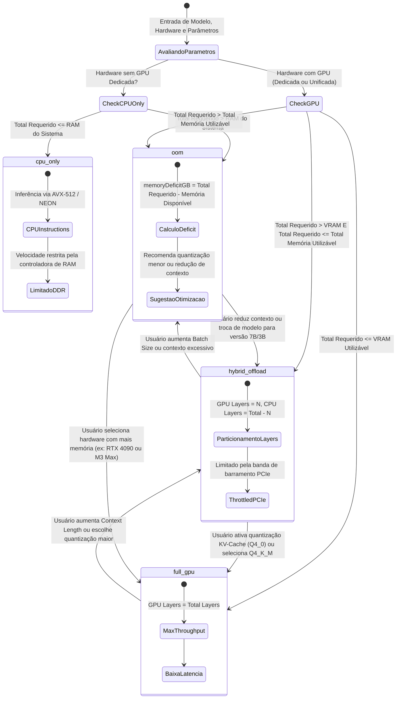

# Máquinas de Estado do Domínio — ai-edge-estimator

> Gerado pelo Detetive (Reversa v1.3.6) em 2026-10-28  
> Nível de Documentação: **Detalhado (3)**

---

## 1. Máquina de Estado de Viabilidade (`FeasibilityStatus`)

O ciclo de vida de uma estimativa de inferência transita entre 4 estados discretos em função da relação entre **Memória Requerida** ($M_{\text{req}}$), **VRAM Utilizável** ($V_{\text{usable}}$) e **Memória Total Utilizável** ($T_{\text{usable}}$).

### Estados Possíveis:
1. `full_gpu`: Execução 100% acelerada na VRAM da GPU dedicada ou pool unificado Metal.
2. `hybrid_offload`: Execução dividida com descarregamento parcial de layers entre GPU e CPU/RAM.
3. `cpu_only`: Execução 100% em processador x86/ARM sem uso de GPU.
4. `oom`: Out Of Memory. O modelo não cabe no hardware.

---

### Diagrama de Estados em Mermaid

---

## 2. Transições e Gatilhos de Negócio

| Estado Inicial | Gatilho / Ação do Usuário | Condição de Transição | Estado Destino | Impacto na Experiência |
|---|---|---|---|---|
| `full_gpu` | Aumenta `contextLength` | $M_{\text{req}} > V_{\text{usable}} \land M_{\text{req}} \le T_{\text{usable}}$ | `hybrid_offload` | Queda substancial de tokens/s; alerta visual amarelo |
| `hybrid_offload` | Ativa KV Cache `Q4_0` | Reduz $M_{\text{req}}$ de modo que $M_{\text{req}} \le V_{\text{usable}}$ | `full_gpu` | Recuperação de 100% dos layers em GPU; velocidade salta 3x |
| `hybrid_offload` | Seleciona quantização `FP16` | $M_{\text{req}} > T_{\text{usable}}$ | `oom` | Banner vermelho de erro; cálculo exato do déficit em GB |
| `oom` | Reduz `contextLength` para 4096 | $M_{\text{req}} \le T_{\text{usable}}$ | `hybrid_offload` ou `full_gpu` | Modelo volta a ser executável |
