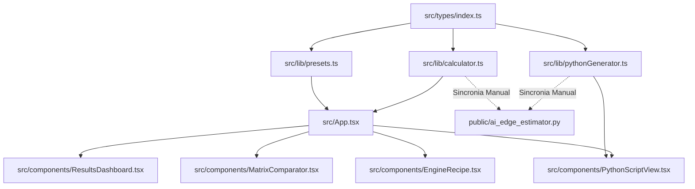

# Matriz de Impacto e Rastreabilidade — ai-edge-estimator

> Gerado pelo Arquiteto (Reversa v1.3.6) em 2026-10-28  
> Nível de Documentação: **Detalhado (3)**

---

## 1. Matriz de Impacto Cruzado de Componentes

Esta matriz determina como a alteração em um componente ou módulo do sistema propaga impacto para os demais componentes.

| Componente Alterado | Impacto em `calculator.ts` | Impacto em `presets.ts` | Impacto em `pythonGenerator.ts` | Impacto em `ResultsDashboard` | Impacto em `MatrixComparator` | Impacto em `EngineRecipe` |
|---|---|---|---|---|---|---|
| **`types/index.ts`** | 🔴 Alto (Assinaturas e interfaces de resultado) | 🔴 Alto (Campos de modelos e perfis) | 🔴 Alto (Dataclasses e tipos gerados) | 🔴 Alto (Propriedades exibidas) | 🔴 Alto (Campos da matriz) | 🔴 Alto (Flags consumidas) |
| **`calculator.ts`** | - | ⚪ Nenhum | 🔴 Alto (Necessita sincronizar Python CLI) | 🔴 Alto (Métricas e badges) | 🔴 Alto (Resultados cruzados) | 🟡 Médio (Divisão de layers) |
| **`presets.ts`** | ⚪ Nenhum | - | 🟡 Médio (Atualizar defaults do script CLI) | 🟢 Baixo (Apenas opções de dropdown) | 🟡 Médio (Grade de comparações) | 🟢 Baixo (Nomes de modelos) |
| **`pythonGenerator.ts`** | ⚪ Nenhum | ⚪ Nenhum | - | ⚪ Nenhum | ⚪ Nenhum | ⚪ Nenhum |
| **`ResultsDashboard.tsx`** | ⚪ Nenhum | ⚪ Nenhum | ⚪ Nenhum | - | ⚪ Nenhum | ⚪ Nenhum |
| **`EngineRecipe.tsx`** | ⚪ Nenhum | ⚪ Nenhum | ⚪ Nenhum | ⚪ Nenhum | ⚪ Nenhum | - |

---

## 2. Mapa de Propagação de Mudanças

